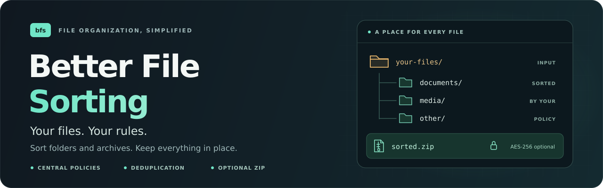
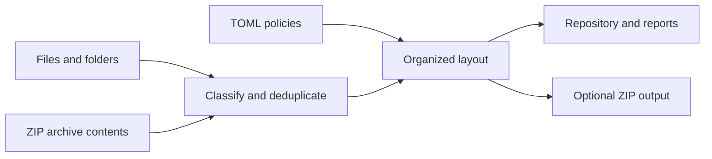

<p align="center">
  <a href="https://github.com/younidev-org/better-file-sorting">
    
  </a>
</p>

<div align="center">

  <p>
    
    <a href="https://github.com/younidev-org/better-file-sorting/releases"></a>
    <a href="LICENSE"></a>
    <a href="docs/README.md"></a>
  </p>

  <p>A command-line tool for sorting files and ZIP collections with configurable policies, deduplication, and optional encrypted ZIP output.</p>

  <p>
    <a href="#features">Features</a> •
    <a href="#showcase">Showcase</a> •
    <a href="#quick-start">Quick Start</a> •
    <a href="#usage">Usage</a> •
    <a href="#development">Development</a> •
    <a href="#guides">Guides</a>
  </p>
</div>

---

## Features

- 📁 Sort ordinary files and folders, or extract entries from ZIP collections.
- 📋 Define matching rules, destination paths, filenames, and duplicate handling in TOML.
- 🔗 Deduplicate content with SHA-256 while retaining source metadata.
- 🔍 Preview the final layout, including filename collisions and duplicate counts.
- 📦 Export a compressed ZIP with optional AES-256 encryption and size-savings reports.
- 🛡️ Apply private permissions, bounded extraction, and cooperative cancellation.



## Showcase

One policy can group files by detected type and retain their original names.
Source files remain untouched; ZIP output contains the selected files and a
`layout.jsonl` index.

<details>
<summary><strong>View a regular-file policy and example output</strong></summary>

```toml
version = 1

[organization]
filename_policy = "regular"
duplicates = "first_only"
default_directory = "{file_type}"
default_filename = "{original_name}"
```

For a folder containing PDF documents and text files, the ZIP layout can look like:

```text
sorted.zip
├── pdf/
│   └── invoice.pdf
├── text/
│   └── notes.txt
└── layout.jsonl
```

The first occurrence of identical content is kept. Conflicting filenames receive
an occurrence identifier before the extension. Classification uses file contents;
it is not based only on extensions.

</details>

## Quick start

Download a Linux executable from [Releases](https://github.com/younidev-org/better-file-sorting/releases),
or build from source with stable Rust and Rust 2024 support:

```sh
cargo build --release --locked
```

The examples below use `bfs` on your `PATH`. For a local build, replace `bfs`
with `target/release/bfs`.

Copy the regular-file policy, then preview and export a folder:

```sh
cp rules.files.example.toml rules.toml

bfs ingest ./documents --input-mode files --rules ./rules.toml \
  --output ./sorted.zip --zip --dry-run

bfs ingest ./documents --input-mode files --rules ./rules.toml \
  --output ./sorted.zip --zip
```

The preview hashes and classifies inputs in sealed temporary storage. It prints
planned destinations, source paths, and duplicate counts without publishing
output. The export refuses existing ZIP destinations and failed or interrupted
runs. Already-compressed files may shrink little or produce a larger ZIP.

## Download collections (0.4.0)

Use [collection.example.toml](collection.example.toml) to discover direct ZIP links
on one HTTP(S) page, preview selection, and download into sealed private staging:

```sh
bfs discover --config collection.toml
bfs download --config collection.toml --dry-run
bfs download --config collection.toml
```

Downloads have `0000` permissions. Explicitly unlock all receipt-owned ZIPs
before ingestion, using their paths in the download report/control receipts:

```sh
chmod 600 ./collection/downloads/payloads/TITLE/FILE.zip
bfs ingest --config collection.toml --dry-run
bfs ingest --config collection.toml
```

Ingest with no explicit input paths verifies completed receipts and hashes before
processing. Explicit local inputs keep their existing behavior. Completed downloads
are retained; BFS never automatically unseals or deletes them. After unlocking,
`download` intentionally refuses reuse until you explicitly reseal the files
with `chmod 000`. Sealing is a file-permission safeguard, not a sandbox.

Title means visible link text; date ordering uses discovery time. Policies choose
which ZIPs to download and stage; existing sorting rules organize their contents.
See [acquisition configuration](docs/commands.md#acquisition-commands) for limits.

## Usage

CLI options override [runtime configuration](config.example.toml). Sorting rules
are shared across repository and ZIP output. See the [command reference](docs/commands.md)
for every argument, default, report field, and exit code.

### Files, archives, and repositories

Use `--input-mode files` for ordinary folders. The default input mode searches
for ZIP archives and extracts their entries; ZIPs are treated as ordinary files
when file mode is selected.

<details>
<summary><strong>Commands</strong></summary>

| Task | Command |
| --- | --- |
| Show all ingest options | `bfs ingest --help` |
| Sort ordinary files into a readable private repository | `bfs ingest ./documents --input-mode files --rules ./rules.files.example.toml --output ./repository --security-mode standard` |
| Inspect ZIP metadata without extracting contents | `bfs inspect ./downloads` |
| Ingest ZIP entries into a sealed repository | `bfs ingest ./downloads --rules ./rules.example.toml --output ./samples` |
| Preview destinations before ingest | `bfs ingest ./downloads --rules ./rules.example.toml --output ./samples --dry-run` |
| Show repository statistics | `bfs stats ./repository` |
| Preview new rules for an existing repository | `bfs reorganize ./repository --rules ./rules.toml --dry-run` |
| Publish a new view with updated rules | `bfs reorganize ./repository --rules ./rules.toml` |
| Limit discovery to immediate children | `bfs ingest ./documents --input-mode files --recursive false --output ./repository` |
| Load runtime settings from TOML | `bfs ingest --config ./config.toml` |

</details>

The default filename policy requires `.sample` filenames. The
[regular-file policy](rules.files.example.toml) preserves ordinary names and
extensions. Archive inputs and archive-derived records refuse the regular
policy; older metadata without input-mode provenance is treated as archive-derived.
Empty directories are not copied.

Repositories store deduplicated objects, source metadata, reports, and logical
views. Reorganization uses metadata without unlocking payloads, and retains
previous views. A ZIP export is an output layout, not a repository backup.

### ZIP output and passwords

`--password-file` supplies candidates for decrypting input archives.
`--output-password-file` independently sets an output ZIP password. Password
files must have `0600` permissions; an output password file must contain exactly
one nonempty password line. Configured password files and their hard links are
excluded from discovered inputs.

<details>
<summary><strong>Commands</strong></summary>

| Task | Command |
| --- | --- |
| Sort ordinary files into a ZIP | `bfs ingest ./documents --input-mode files --rules ./rules.files.example.toml --zip --output ./sorted.zip` |
| ZIP selected sorted directories together | `bfs ingest ./documents --input-mode files --rules ./rules.files.example.toml --zip-dir documents/pdf --zip-dir text --output ./selected.zip` |
| Create one ZIP per top-level sorted directory | `bfs ingest ./documents --input-mode files --rules ./rules.files.example.toml --zip-each-dir --output ./exports` |
| Create separate ZIPs for selected directories | `bfs ingest ./documents --input-mode files --rules ./rules.files.example.toml --zip-dir documents/pdf --zip-dir text --zip-each-dir --output ./exports` |
| Encrypt the output ZIP with AES-256 | `bfs ingest ./documents --input-mode files --rules ./rules.files.example.toml --zip --output ./private.zip --output-password-file ./output-password.txt` |
| Decrypt archive inputs and export their sorted contents | `bfs ingest ./downloads --password-file ./input-passwords.txt --rules ./rules.example.toml --zip --output ./sorted.zip` |
| Select temporary storage for ZIP output | `bfs ingest ./documents --input-mode files --rules ./rules.files.example.toml --zip --output ./sorted.zip --staging-dir /existing/scratch` |

</details>

`--zip-dir` and `--zip-each-dir` enable ZIP output automatically. Selections refer
to sorted destination directories, include descendants, and support the same
optional password. Separate mode uses a new output directory and retains the
sorted hierarchy: `documents/pdf` becomes `exports/documents/pdf.zip`. Each ZIP
contains its own layout index; unselected files are omitted from the export.
Use `--dry-run` to preview archive destinations. See the
[selection reference](docs/commands.md#selecting-sorted-directories) for details.

ZIP reports include per-archive sizes, aggregate output size, selected payload size, signed savings,
and total elapsed time. Negative savings mean the ZIP grew. ZIP filenames remain
visible when contents are encrypted; extraction requires an AES-compatible reader.
Archive previews read and decompress entries and therefore need input passwords.
Use `inspect` when only archive metadata is needed.

### Permissions and temporary storage

| Setting | Behavior |
| --- | --- |
| `sealed` repository mode (default) | Payload permissions are `0000`; automatic unsealing is refused. |
| `standard` repository mode | Payloads are readable and writable by their owner (`0600`). |
| ZIP output | Uses a disposable private, readable repository and publishes a `0600` ZIP only after success. |
| Preview | Uses sealed disposable storage and includes existing destination metadata without changing its current view. |
| `--staging-dir <DIR>` | Creates a private `0700` working directory beneath an existing directory; normal repository ingestion keeps its internal staging location. |

ZIP staging defaults to the output directory; preview staging defaults to the
system temporary directory. ZIP mode requires space for uncompressed,
deduplicated inputs plus the compressed output. Final publication stays in the
output directory even when staging is on another filesystem.

> [!IMPORTANT]
> File permissions are not a malware sandbox. Use an isolated environment for
> untrusted samples. A forced termination or crash can leave private plaintext
> ZIP staging under `.bfs-zip-*`; select an encrypted filesystem when crash
> confidentiality is required. Normal completion and handled errors clean up
> temporary storage. Preview payloads remain sealed, though metadata can survive
> a crash.

## Development

Use stable Rust with Rustfmt and Clippy. Cargo Nextest is optional; install it
with `cargo install cargo-nextest --locked` to use the same test runner as CI.

<details>
<summary><strong>Build and verification commands</strong></summary>

| Task | Command |
| --- | --- |
| Build the release executable | `cargo build --release --locked` |
| Check formatting | `cargo fmt --all -- --check` |
| Apply formatting | `cargo fmt --all` |
| Run Clippy | `cargo clippy --locked --all-targets --all-features -- -D warnings` |
| Run tests and doctests with Cargo | `cargo test --locked` |
| Run tests with Nextest | `cargo nextest run --locked` |

</details>

## Guides

Choose a reference by task, or browse the [documentation hub](docs/README.md).

| I want to… | Start here |
| --- | --- |
| Look up commands, options, report fields, or exit codes | [Command reference](docs/commands.md) |
| Configure discovery, limits, workers, and staging | [Runtime configuration](config.example.toml) |
| Customize sample sorting and duplicate handling | [Sample rules](rules.example.toml) |
| Preserve ordinary filenames and extensions | [Regular-file rules](rules.files.example.toml) |
| Read packaged release usage notes | [Release guide](docs/RELEASE_README.md) |
| Review validation evidence and limitations | [Validation record](docs/validation.md) |

## Tech stack

<p>
  <a href="https://www.rust-lang.org/"></a>
  <a href="https://doc.rust-lang.org/edition-guide/rust-2024/"></a>
  
  <a href="https://github.com/features/actions"></a>
</p>

---

## License

Distributed under the [GNU GPL v3.0](LICENSE).
