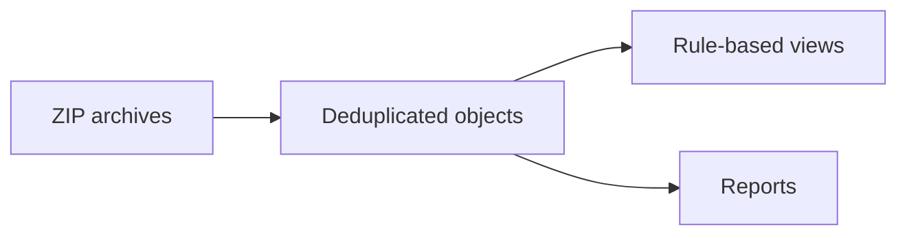

<a href="https://github.com/younidev-org/better-file-sorting"></a>

<div align="center">

  <p>
    
    <a href="https://www.rust-lang.org/"></a>
    <a href="https://github.com/younidev-org/better-file-sorting/releases"></a>
    <a href="LICENSE"></a>
    <a href="docs/README.md"></a>
  </p>

  <p>A CLI that turns ZIP sample collections into deduplicated, organized repositories.</p>

  <p>
    <a href="#features">Features</a> •
    <a href="#quick-start">Quick Start</a> •
    <a href="#development">Development</a> •
    <a href="#guides">Guides</a>
  </p>
</div>

---

## Features

- **Ingest** unencrypted, ZipCrypto, and AES ZIP entries without executing samples.
- **Organize** by metadata rules, with SHA-256 deduplication and file classification.
- **Sort folders** without modifying sources; optionally publish only a compressed ZIP with AES-256 password protection.
- **Inspect** duplicates, failures, and storage usage through JSON reports.
- **Restrict access** with Unix permissions and sealed storage by default.



> [!CAUTION]
> Sealed permissions are not a malware sandbox. Use an isolated environment and keep password files private (`0600`). Never commit samples or credentials.

## Quick start

Requires Linux and stable Rust with Rust 2024 support. The CLI executable is `bfs`.

### 1. Build and configure

```sh
cargo build --release
cp config.example.toml config.toml
cp rules.example.toml rules.toml
```

### 2. Inspect and ingest

```sh
target/release/bfs inspect ./downloads
target/release/bfs ingest ./downloads \
  --output ./repository --config ./config.toml --rules ./rules.toml
target/release/bfs stats ./repository
```

### 3. Preview a new layout

```sh
target/release/bfs reorganize ./repository --rules ./rules.toml --dry-run
```

### Sort regular folders and ZIP the result

```sh
# Sort ordinary files (ZIPs are treated as files rather than extracted).
target/release/bfs ingest ./documents --input-mode files \
  --output ./repository --rules ./rules.toml

# Keep only the sorted ZIP output, without a permanent repository.
target/release/bfs ingest ./documents --input-mode files --zip \
  --output ./sorted.zip --rules ./rules.toml

# Optional AES-256 password: one nonempty line in a private (0600) file.
target/release/bfs ingest ./documents --input-mode files --zip \
  --output ./private.zip --rules ./rules.toml \
  --output-password-file ./output-password.txt
```

`--zip` also works with the default archive input mode: extract inputs, sort
their entries, then compress the resulting layout. `--password-file` supplies
input decryption candidates; `--output-password-file` independently sets the
output password. Both password files, including hard links, are excluded from
discovered inputs.

Sorting policy stays in one rules TOML: ordered matchers, directory/filename
templates and duplicate handling apply to both input modes and output formats.
The existing safety policy requires filenames ending in `.sample`; for readable
names use `default_filename = "{original_name}.sample"`. In file mode,
`source_archive` identifies the source file and `encrypted` is false.
Use `--recursive false` for immediate children only, or `--dry-run` to list
discovered files without writing output. Empty directories are not copied.

Sources are never moved or deleted. Repository output retains the configured
security mode (sealed by default). ZIP output uses a disposable private,
readable repository, never unlocks existing sealed storage, and is published
as a `0600` file only after a successful run. It refuses existing output paths
and partial/failed runs. The ZIP includes policy-selected payloads and
`layout.jsonl`, even with `view_mode = "manifest"`; it is not a repository
backup. ZIP filenames remain visible when contents are encrypted; extraction
requires an AES-compatible reader.

An uncatchable kill or crash may leave private plaintext staging under
`.bfs-zip-*` beside the output; use an encrypted filesystem for that location
when crash confidentiality is required. Normal completion and handled errors
remove temporary storage.

ZIP mode needs temporary space for the uncompressed, deduplicated inputs plus
the compressed output. Already-compressed files may shrink little. File count
is bounded by `max_entries`, and each ordinary file by the smallest of
`max_entry_bytes`, `max_input_bytes` and `max_archive_bytes`.

## Development

| Need | Command |
| --- | --- |
| Check formatting | `cargo fmt --all -- --check` |
| Run Clippy | `cargo clippy --locked --all-targets --all-features -- -D warnings` |
| Run tests | `cargo nextest run --locked` |

## Guides

Choose a reference by task, or browse the [documentation hub](docs/README.md).

| I want to… | Start here |
| --- | --- |
| Look up commands, options and examples | [Command reference](docs/commands.md) |
| Configure ingestion and limits | [Configuration template](config.example.toml) |
| Customize sorting and duplicates | [Organization rules](rules.example.toml) |
| Understand release usage and safety | [Release guide](docs/RELEASE_README.md) |
| Review tests and known limitations | [Validation record](docs/validation.md) |

---

## License

Distributed under the [BSD 3-Clause](LICENSE).
